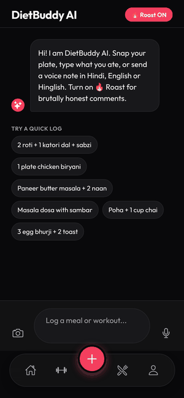
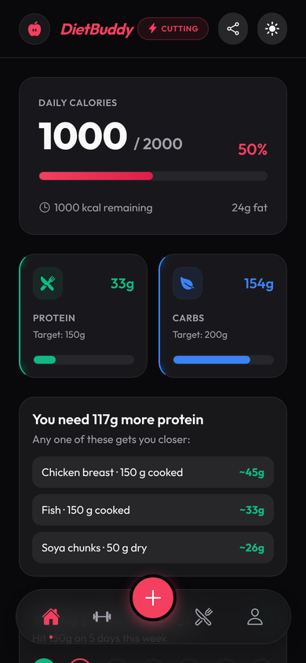
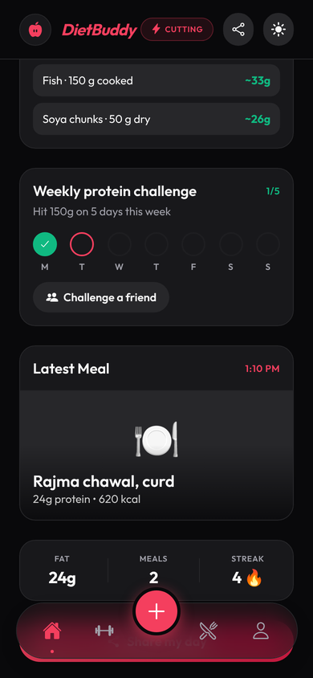
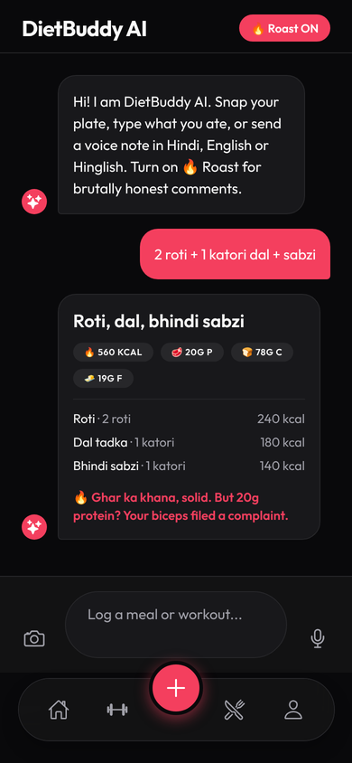
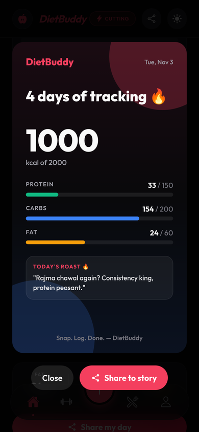

# DietBuddy 🍛

**Snap your plate. Get your macros. Get roasted.**

DietBuddy is an AI calorie and macro tracker built for Indian food. Take a photo of your thali, type "2 roti + 1 katori dal", or send a voice note in Hinglish, and Gemini breaks it down item by item.

<p align="center">
  
</p>

## Features

- **Desi food first** — recognises roti, dal, sabzi, biryani, dosa, paneer and more, with Indian portions (katori, plate, roti count) and an item-by-item breakdown.
- **Log any way** — photo, text, or a voice note in Hindi, English or Hinglish.
- **🔥 Roast my plate** — flip on Roast mode for a savage one-liner about every meal.
- **Share your day** — a story-sized card with your macros, streak and today's roast, ready for Instagram.
- **Streaks** — keep your logging streak alive day after day.
- **Weekly protein challenge** — hit your protein goal on 5 days a week, and challenge a friend.
- **Protein gap alerts** — see how much protein you still need and what to eat (paneer, soya, eggs, chicken…).
- **Calories, protein, carbs and fat** tracked against your bulking or cutting goal.
- **Saved on your phone** — logs persist, totals reset at midnight, history is kept.

## Screenshots

| Home | Protein challenge | AI breakdown + roast | Share card |
|:---:|:---:|:---:|:---:|
|  |  |  |  |

<sub>Captured from the web build with sample data and a sample AI response.</sub>

## Tech stack

React Native · Expo 54 · Zustand (persisted with AsyncStorage) · Gemini (via a Vercel serverless function) · react-native-view-shot + expo-sharing

## Setup

1. Deploy the API in [`server/`](server/README.md). It holds the Gemini key, so the key never ships inside the app.
2. Copy `.env.example` to `.env` and set `EXPO_PUBLIC_API_URL` to the deployed URL.
3. Install and run:

   ```bash
   npm install
   npx expo start
   ```

## Project structure

```
src/
  screens/      Home, Add (AI chat), Log, Workout, History, Onboarding
  components/   ShareCard, ShareModal
  services/     mealService.js — calls the API
  store/        useStore.js — persisted app state
  utils/        nutrition.js — streaks, weekly challenge, protein suggestions
server/
  api/analyze-meal.js — Gemini proxy (Vercel function)
```

## Roadmap

- Friend leaderboards for challenges (needs accounts + a backend database)
- Real data on the Log and Workout tabs
- Water and steps tracking
